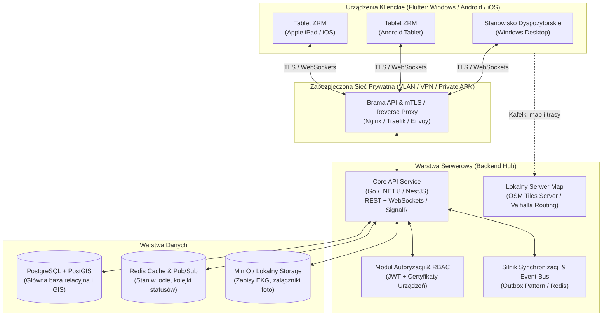
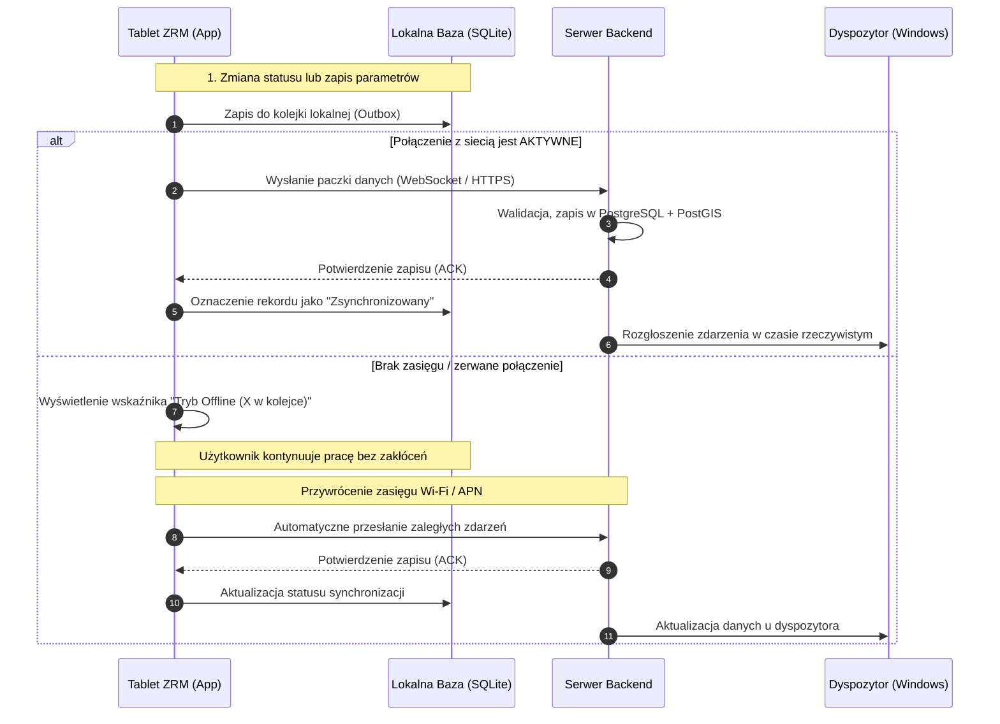

# Architektura Systemu Wspomagania Dowodzenia Ratownictwa (Wzór SWD PRM)

Dokument opisuje architekturę systemu dyspozytorsko-mobilnego opartego na zasadach i funkcjonalnościach znanych z **SWD PRM** (System Wspomagania Dowodzenia Państwowego Ratownictwa Medycznego), dostosowanego do działania na platformach **Windows** (stacja dyspozytorska / laptop), **Android** oraz **iOS** (tablety zespołów ratowniczych), w ramach **zabezpieczonej sieci prywatnej** (izolowany LAN / dedykowany APN / VPN).

---

## 1. Główne założenia i wymagania

1. **Wieloplatformowość (Cross-platform):**
   - **Tablety ZRM (Zespołów Ratownictwa Medycznego):** Android oraz iPad (iOS).
   - **Stanowisko Dyspozytora / Szpitalne:** Windows (oraz tablety pancerne z Windows).
   - Jeden wspólny stos technologiczny frontendu dla zachowania spójności interfejsu, walidacji medycznych i niskich kosztów utrzymania.
2. **Bezpieczna, izolowana sieć:**
   - Działanie w sieci lokalnej (intranet) bez konieczności ciągłego dostępu do publicznego Internetu.
   - Lokalny serwer kafelków map (OpenStreetMap Offline Tile Server) oraz serwer czasu (NTP).
   - Szyfrowanie połączeń: TLS 1.3 / mTLS (dwukierunkowe uwierzytelnianie certyfikatami urządzeń).
3. **Podejście Offline-First:**
   - Zespół w terenie (np. w piwnicy, windzie lub strefie bez zasięgu) musi mieć możliwość ciągłego wypełniania KMCR (Karty Medycznych Czynności Ratunkowych) oraz rejestrowania czasów.
   - Dane buforowane lokalnie w szyfrowanej bazie i automatycznie synchronizowane po odzyskaniu łączności z serwerem.
4. **Przesyłanie zdarzeń w czasie rzeczywistym:**
   - Natychmiastowa aktualizacja statusów operacyjnych (kody 1–6) oraz przesyłanie nowych zleceń wyjazdu (KZW) bez opóźnień.

---

## 2. Diagram Architektury Systemu

---

## 3. Wybór Stosu Technologicznego

### 3.1. Aplikacja Kliencka (Windows + Android + iOS)
> **Rekomendacja: Flutter (Dart)**
> 
> - **Dlaczego Flutter?**
>   - Oficjalne, dojrzałe wsparcie kompilacji do kodu natywnego na **Windows**, **Android** oraz **iOS** z jednego repozytorium kodu.
>   - Wysoka wydajność renderowania formularzy medycznych (dynamiczne skale, np. GCS, APGAR, kalkulatory dawek leków) i map wektorowych/rastrowych.
>   - Spójny wygląd i zachowanie UI niezależnie od wersji systemu operacyjnego.
>   - Gotowe biblioteki do obsługi lokalnych baz danych SQLite/Drift oraz szyfrowania SQLCipher.

### 3.2. Warstwa Serwerowa (Backend)
- **Opcja A (Rekomendowana): Go (Golang) lub .NET 8 (C#)**
  - Niezrównana wydajność, niski narzut pamięciowy, doskonała obsługa połączeń WebSocket / gRPC na żywo.
  - Alternatywa: **NestJS / TypeScript**, jeśli priorytetem jest prostota ekosystemu JS/TS.
- **Baza danych:**
  - **PostgreSQL z rozszerzeniem PostGIS:** Wiodący standard do obsługi danych relacyjnych, historii zmian, audytu oraz danych geoprzestrzennych.
  - **Redis:** Pamięć podręczna, bufor statusów pojazdów, broker zdarzeń (Pub/Sub) dla komunikatów WebSockets.
- **Lokalne usługi pomocnicze (wewnątrz sieci):**
  - **Lokalny serwer kafelków map (TileServer GL / OSM):** Zapewnia mapy bez dostępu do Internetu.
  - **MinIO:** Magazyn obiektowy kompatybilny z S3 do przechowywania plików (np. skany dokumentów, zdjęcia z miejsca wypadku, eksporty PDF kart KMCR).

---

## 4. Kluczowe Moduły Funkcjonalne

### 4.1. Moduł Statusów Operacyjnych ZRM (Inspirowany SWD PRM)
Jedno-klikowe przełączanie statusów zespołu ratownictwa medycznego:
- **Status 1:** Wyjazd na miejsce zdarzenia
- **Status 2:** Przybycie na miejsce zdarzenia
- **Status 3:** Przejęcie pacjenta / rozpoczęcie czynności medycznych
- **Status 4:** Rozpoczęcie transportu do szpitala (SOR)
- **Status 5:** Przybycie do szpitala / przekazanie pacjenta
- **Status 6:** Zakończenie czynności / powrót / gotowość operacyjna

Każda zmiana statusu rejestruje:
- Czas zdarzenia (zsynchronizowany z serwerem czasu).
- Pozycję GPS zespołu w momencie kliknięcia.
- Identyfikator członka zespołu dokonującego wpisu.

### 4.2. Karta Zlecenia Wyjazdu (KZW)
- Odbierana na tablecie natychmiast po zadysponowaniu przez dyspozytora.
- Zawiera: priorytet wyjazdu (kod 1 / kod 2), powód wezwania, dane pacjenta, adres i współrzędne geograficzne, notatki dyspozytora, zalecenia dot. bezpieczeństwa.

### 4.3. Karta Medycznych Czynności Ratunkowych (KMCR)
- Rozbudowany formularz offline-first:
  - Wywiad ratowniczy (SAMPLE).
  - Badanie przedmiotowe i parametry życiowe (tętno, RR, SpO2, EtCO2, glikemia, temperatura, EKG).
  - Skale medyczne: GCS (Glasgow Coma Scale), RTS, APGAR, skala bólu VAS/NRS.
  - Zastosowane leki i procedury medyczne (z bazą leków, dawek i dróg podania).
  - Rozpoznanie wg ICD-10.
  - Decyzja o transporcie i podpis pacjenta / personelu medycznego.
- Generowanie gotowego raportu PDF po przekazaniu pacjenta na SOR.

### 4.4. Moduł Dyspozytora (Windows)
- Podgląd mapy w czasie rzeczywistym z pozycją wszystkich aktywnych karetek/zespołów.
- Lista aktywnych zdarzeń i kolejka zgłoszeń.
- Matryca statusów (widok kafelkowy/tabelaryczny ze stanem gotowości każdego zespołu).
- Komunikator tekstowy pomiędzy dyspozytornią a poszczególnymi tabletami.

---

## 5. Mechanizm Działania w Zabezpieczonej Sieci i Pracy Offline

